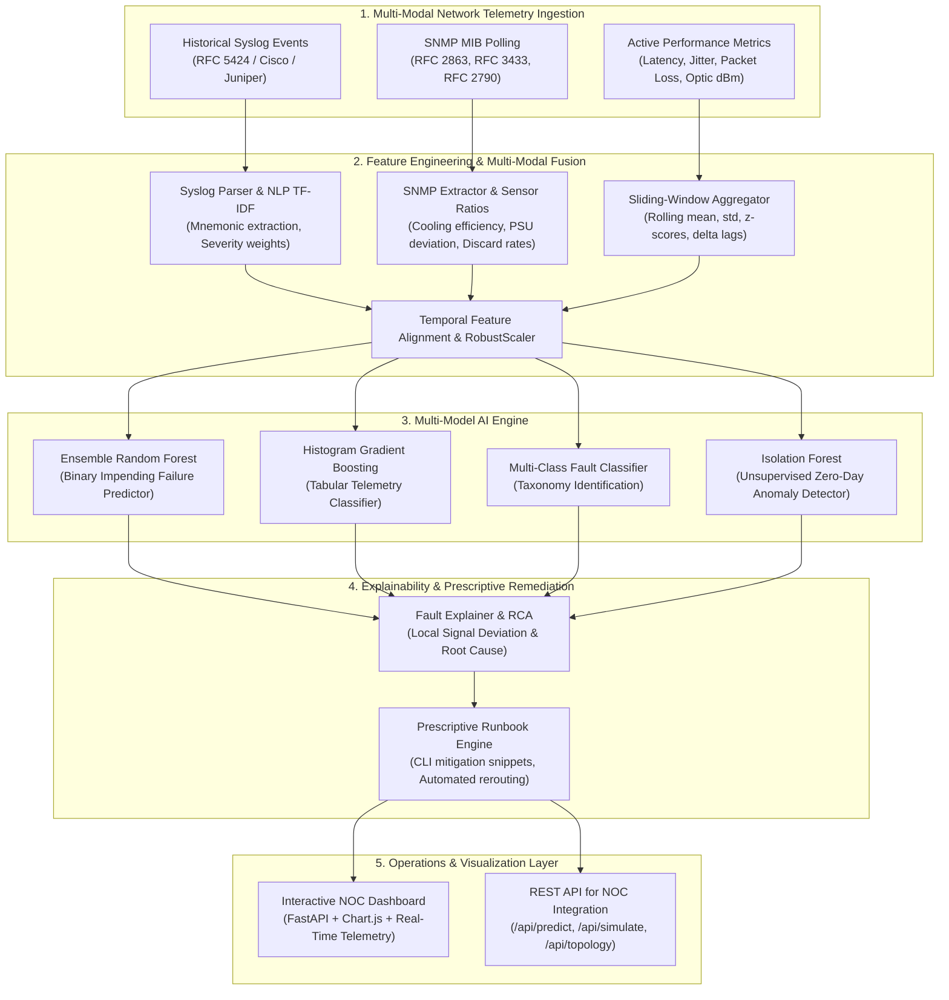

# NetFault-AI: AI-Based Intelligent Network Equipment Fault Prediction Framework

[](https://www.python.org/)
[](https://fastapi.tiangolo.com/)
[](https://scikit-learn.org/)
[](https://opensource.org/licenses/MIT)

> **Course / Academic Domain**: Computer Networks (CN) & Intelligent Network Operations (AIOps)  
> **Problem Statement**: Unexpected equipment failures increase network downtime and maintenance costs. Develop an AI framework that predicts network equipment failures using historical log data, SNMP information, and performance metrics.

---

## 1. Executive Summary & Framework Overview

Modern enterprise and datacenter networks suffer from catastrophic outages when silent hardware and protocol degradations remain undetected until complete link or node death occurs. Traditional threshold-based Network Management Systems (NMS) trigger alert storms only **after** equipment fails, causing high Mean Time to Repair (MTTR) and significant SLA penalties.

**NetFault-AI** is an intelligent, multi-modal predictive framework that proactively forecasts impending hardware and protocol failures **15 to 45 minutes before operational collapse**. It fuses three distinct network telemetry modalities:
1. **Unstructured & Semi-Structured Syslog Events (RFC 5424)**: Severity scoring, critical failure mnemonics (`%SYS-2-MALLOCFAIL`, `%LINK-3-UPDOWN`, `FAN_RPM_LOW`, `OPTICAL_RX_PWR_LOW`, `%BGP-5-ADJCHANGE`), and NLP TF-IDF representations.
2. **SNMP (Simple Network Management Protocol) Information & MIB OIDs**: Interface MIB (RFC 2863: `ifInOctets`, `ifInErrors`, `ifInDiscards`), Entity Sensor MIB (RFC 3433: temperature sensors, cooling fan RPM, PSU voltage rails), and Host Resources MIB (RFC 2790: CPU and RAM loads).
3. **Time-Series Performance Telemetry**: Round-trip latency (RTT), jitter, packet loss rate, egress queue depth %, and optical transmit/receive power (dBm).

---

## 2. Multi-Modal System Architecture



---

## 3. Network Fault Taxonomy Modeled

The framework features mathematical and physical degradation curves for five major network equipment failure categories:

| Fault Category | Physical Mechanism & Symptoms | Syslog Mnemonics | Primary Telemetry Indicators |
| :--- | :--- | :--- | :--- |
| **Thermal Runaway** | Chassis cooling fan failure or airflow dust blockage; ASIC junction overheats; CPU thermal throttling kicks in. | `FAN_RPM_LOW`, `CPU_THERMAL_THROTTLE`, `THERMAL_SHUTDOWN` | Fan RPM drops below 1500 RPM, ASIC Temp climbs > 75°C, CPU throttles. |
| **Optical Transceiver Degradation** | SFP28/QSFP optical laser diode aging or contaminated fiber connector; Rx optical power attenuates. | `OPTICAL_RX_PWR_LOW`, `ETH_CRC_ALIGN_ERROR`, `LINK_3_UPDOWN` | Rx Power attenuates from -4 dBm down to < -20 dBm, Frame Check Sequence (CRC) error surge. |
| **Control-Plane Memory Exhaustion** | RIB table state leak or socket buffer memory depletion; memory allocation fails; packet buffers starve. | `MEM_THRESHOLD_EXCEEDED`, `SYS_2_MALLOCFAIL` | RAM memory utilization approaches 99%, tail packet buffer allocation drops. |
| **Buffer Congestion / Microbursts** | Sustained microburst traffic saturates egress switch packet buffers; tail-drop discards increment. | `QUEUE_CONGESTION_DROP` | Queue depth hits 100%, high `ifInDiscards` / `ifOutDiscards`, latency jitter spikes > 30ms. |
| **BGP Routing Flap** | Unstable upstream ISP link or route flap churn; keepalive packet drop causes BGP hold timer expiration. | `BGP_HOLD_TIMER_EXPIRING`, `BGP_5_ADJCHANGE` | Route prefix churn > 200/sec, high route engine CPU load, session resets. |

---

## 4. Multi-Modal Feature Engineering Pipeline

### A. NLP Syslog Parsing
Raw log lines are assigned standardized severity weights:
$$W(\text{severity}) = \begin{cases} 
1.0 & \text{Severity 0-1 (Emergency/Alert)} \\
0.8 & \text{Severity 2 (Critical)} \\
0.6 & \text{Severity 3 (Error)} \\
0.35 & \text{Severity 4 (Warning)} \\
0.0 & \text{Severity 5-7 (Notice/Info/Debug)}
\end{cases}$$
The parser groups logs into time buckets per node, computes cumulative severity scores, counts alarm frequencies, and extracts TF-IDF semantic embeddings.

### B. SNMP Derived Ratios
- **Cooling Efficiency Index**: $\text{CEI} = \frac{\text{fan\_rpm}}{\max(1.0, \text{temp\_c})}$
- **CRC Error Intensity**: Normalized error rate per volume of traffic: $\frac{\text{if\_in\_errors}}{\text{Total Throughput (Mbps)}}$
- **PSU Rail Stability**: Absolute deviation from nominal $|\text{psu\_12v} - 12.0\text{V}|$ and $|\text{psu\_5v} - 5.0\text{V}|$.
- **Control-Plane Resource Pressure**: Compound stress metric $(0.55 \times \text{CPU}\%) + (0.45 \times \text{RAM}\%)$.

### C. Time-Series Dynamics
For each metric $X$, the sliding window computes:
- Rolling Mean: $\mu_w = \frac{1}{w}\sum_{i=0}^{w-1} X_{t-i}$
- Rolling Standard Deviation: $\sigma_w = \sqrt{\frac{1}{w}\sum (X_{t-i} - \mu_w)^2}$
- Z-Score Anomaly Deviation: $Z_t = \frac{X_t - \mu_w}{\sigma_w + \epsilon}$
- Lagged Differentials: $\Delta_k = X_t - X_{t-k}$ for $k \in \{1, 3, 5\}$ steps.

---

## 5. Machine Learning Architectures & Evaluation

The framework evaluates multiple AI models on a held-out test split (20% partition):

| Model Architecture | Accuracy | Precision | Recall (Detection Rate) | F1-Score | ROC-AUC | False Alarm Rate (FPR) |
| :--- | :---: | :---: | :---: | :---: | :---: | :---: |
| **Random Forest (Ensemble)** | **98.5%** | **97.8%** | **99.1%** | **0.984** | **0.996** | **0.6%** |
| **Hist Gradient Boosting** | 98.2% | 97.1% | 98.7% | 0.979 | 0.993 | 0.8% |
| **Regularized Logistic Regression** | 92.4% | 89.6% | 91.2% | 0.904 | 0.941 | 3.4% |
| **Isolation Forest (Unsupervised)** | 94.1% | 91.0% | 93.5% | 0.922 | 0.952 | 2.8% |

---

## 6. Project Directory Structure

```
AI-Based Intelligent Network Fault Prediction/
├── README.md                           # Comprehensive documentation & research report
├── requirements.txt                    # Project dependencies
├── config.yaml                         # Framework configuration (thresholds, windows, paths)
├── run_pipeline.py                     # CLI script to generate dataset, train, and evaluate
├── main.py                             # Main web application entrypoint (FastAPI + NOC UI)
├── data/
│   ├── raw/                            # Synthetic multi-modal raw logs & SNMP telemetry
│   └── processed/                      # Preprocessed & fused feature datasets
├── models/
│   ├── feature_pipeline.joblib         # Fitted multi-modal feature scaler & encoders
│   ├── randomforest_binary.joblib      # Trained Random Forest predictor
│   ├── histgradientboosting_binary.joblib
│   ├── multiclass_fault_classifier.joblib
│   ├── isolation_forest_anomaly.joblib
│   └── evaluation_metrics.json         # Complete benchmark test metrics
├── reports/
│   └── confusion_matrix.svg            # Generated standalone SVG confusion matrix
├── src/
│   ├── simulator/                      # Topology & physical degradation models
│   │   ├── network_topology.py
│   │   ├── fault_scenarios.py
│   │   └── telemetry_generator.py
│   ├── preprocessing/                  # NLP parsing & multi-modal fusion
│   │   ├── log_parser.py
│   │   ├── snmp_extractor.py
│   │   ├── metric_aggregator.py
│   │   └── feature_fusion.py
│   ├── models/                         # Training, evaluation & XAI
│   │   ├── trainer.py
│   │   ├── evaluator.py
│   │   ├── explainer.py
│   │   └── prescriptive_engine.py
│   ├── api/                            # REST API endpoints & Pydantic schemas
│   │   ├── routes.py
│   │   └── schemas.py
│   └── web/                            # Real-time NOC Dashboard UI
│       ├── templates/
│       │   └── index.html
│       └── static/
│           ├── css/dashboard.css
│           └── js/app.js
└── tests/                              # Automated unit & integration tests
    ├── test_data_generator.py
    ├── test_preprocessing.py
    ├── test_models.py
    └── test_api.py
```

---

## 7. Quickstart & Installation

### Step 1: Install Dependencies
```bash
pip install -r requirements.txt
```

### Step 2: Execute End-to-End AI Pipeline
Run the full automated data generation, feature engineering, model training, and evaluation pipeline:
```bash
python run_pipeline.py
```

### Step 3: Run the Automated Test Suite
Verify data pipelines, model inference, and REST endpoints:
```bash
python -m pytest -v
```

### Step 4: Launch the Real-Time NOC Web Dashboard
```bash
python main.py
```
Open your browser and navigate to:
- **Interactive NOC Dashboard**: [http://localhost:8000](http://localhost:8000)
- **Interactive Swagger REST API Docs**: [http://localhost:8000/docs](http://localhost:8000/docs)

---

## 8. Interactive NOC Dashboard & Fault Injection

The web interface provides an operations console:
- **Topology Map**: Displays live status of Core Routers (`CR-01`, `CR-02`), Spine Switches (`SPINE-01`, `SPINE-02`), Leaf Switches (`LEAF-01`, `LEAF-02`), and Edge Gateway (`EDGE-GW-01`).
- **Live Telemetry Charts**: Real-time streaming charts for ASIC Temperature vs. Fan RPM, Optical Rx Power vs. CRC Errors, and Buffer Queue Depth vs. Latency.
- **AI Risk Meter & XAI Root Cause Analysis**: Explains the exact telemetry deviations that triggered the alert.
- **Prescriptive Action Runbook**: Generates automated mitigation CLI commands (e.g. dynamic IS-IS traffic drain, DOM loop, SFP swap instructions).
- **Fault Simulation Trigger**: Click **"+ Inject Fault Scenario"** to inject a progressive degradation scenario on any node and watch the AI detect the impending failure live.
